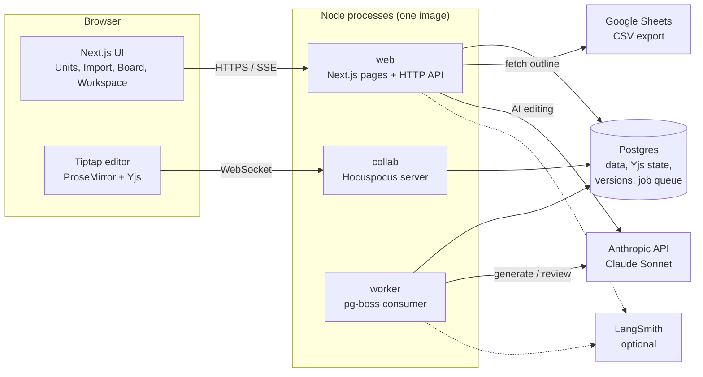
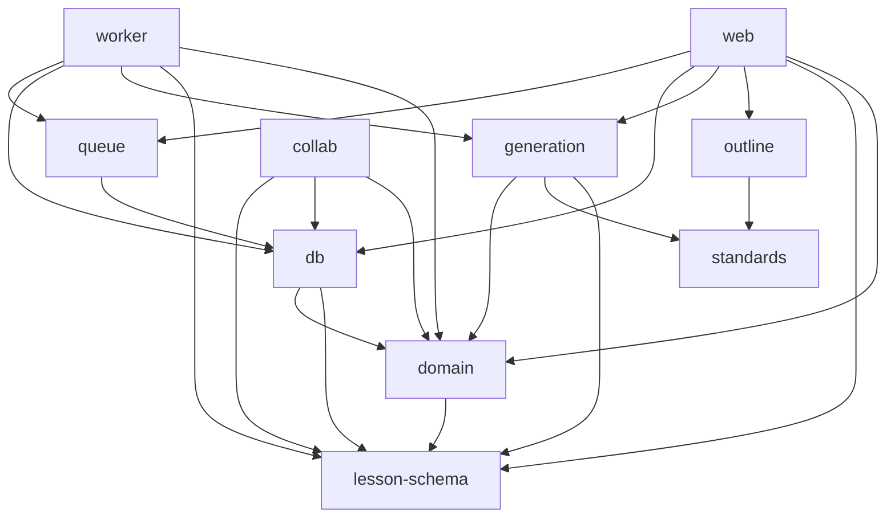
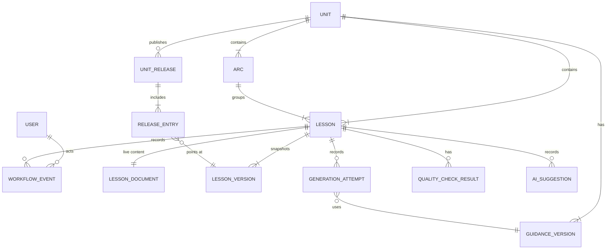
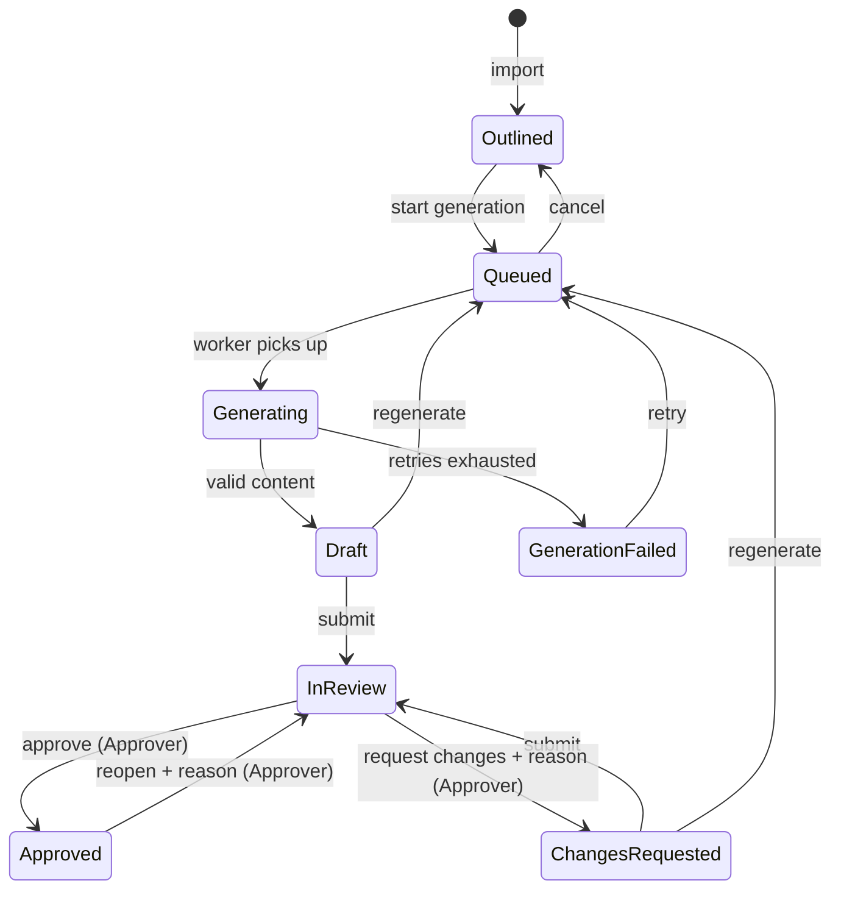
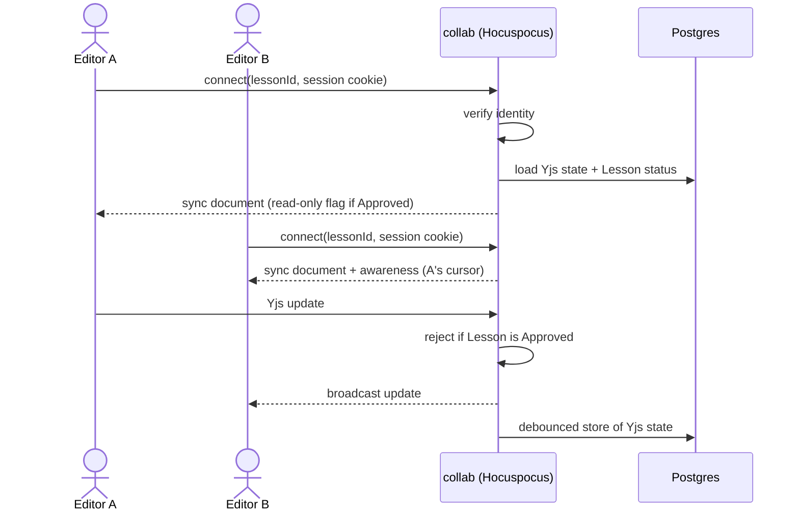

# Architecture

How the Lesson Content Generation tool is put together. Requirements are in [PRD.md](PRD.md), vocabulary in [GLOSSARY.md](../GLOSSARY.md), and the reasoning behind each choice in [adr/](adr/). This document describes the target design; sections are marked when a part is not built yet.

## 1. High-level architecture (HLA)



| Component | Responsibility | Talks to |
|---|---|---|
| **web** | Every screen; HTTP API for import, Units, Lessons, workflow, versions, releases, AI editing; live board updates by server-sent events | Postgres, Anthropic (AI editing), Google Sheets |
| **collab** | Syncs Lesson documents between browsers; authenticates connections; persists Yjs state; refuses writes to Approved Lessons | Postgres |
| **worker** | Runs Generation Attempts and AI Reviews from the job queue at a fixed concurrency; writes documents, versions, digests, checks | Postgres, Anthropic |
| **Postgres** | The only stateful service ([ADR 0003](adr/0003-postgres-only-state-and-pg-boss-queue.md)) | none |

Key properties:
- **One source of truth per kind of fact.** Standards text comes from the checked-in dataset ([ADR 0006](adr/0006-checked-in-standards-dataset.md)); Lesson content comes from the Lesson document; workflow state comes from the Lesson row and its event log.
- **Lesson content flows through one module.** Live edits arrive through collab; generated content and version restores go through the same document persistence module ([ADR 0004](adr/0004-hocuspocus-yjs-live-collaboration.md)).
- **Rules live in pure packages.** Apps are thin adapters ([ADR 0002](adr/0002-typescript-pnpm-monorepo.md)).

## 2. Low-level architecture (LLA)

### 2.1 Workspace layout

```
apps/
  web/          Next.js pages, API route handlers, editor UI
  worker/       job handlers: generate-lesson, review-lesson
  collab/       Hocuspocus server: auth, persistence, read-only guard
packages/
  domain/       Lesson state machine, permissions, Quality Check rules, release rules (pure)
  lesson-schema/ Lesson JSON schema, ProseMirror schema, conversions, Student View (pure)
  outline/      Outline parsing, row classification, Outline Issue detection
  standards/    built standards dataset, lookups, build script
  generation/   prompt builder, LLM client (live/replay/fake), AI Review, AI editing
  db/           Drizzle schema, migrations, repositories, document persistence, seed
  queue/        job-queue interface + pg-boss implementation
  session/      signs and verifies the identity cookie (web and collab)
fixtures/       sample outline, recorded AI responses, seed Unit
e2e/            Playwright main-path test
```

### 2.2 Package dependencies



`domain`, `lesson-schema` and `standards` do no I/O and depend on nothing outside the workspace except schema/validation libraries. Everything else depends inward on them.

### 2.3 Data model



- `LESSON.status` holds the current workflow state, plus a `revision` counter used for optimistic concurrency on transitions.
- `LESSON_DOCUMENT` holds Yjs state as bytes; `LESSON_VERSION` holds immutable Lesson JSON.
- `WORKFLOW_EVENT` is append-only and is the audit trail (actor, from, to, reason, self-approval flag, failing-checks flag).

### 2.4 Lesson workflow



Editable states: Draft, In Review, Changes Requested. Approved is read-only, enforced by `collab` and the API.

### 2.5 Lesson document

One structured ProseMirror document per Lesson ([ADR 0001](adr/0001-lesson-as-one-structured-document.md)):

```
lesson
├── lessonHeader   (standards, objectives, essential questions, pacing, vocabulary, texts)
├── section[launch]
├── section[literacyLab]        (Lesson Type dependent)
├── section[learningInAction]
│     └── activity (title, minutes, standards[])
│           ├── teacherScript / directions / sampleResponse / teacherNote
│           ├── pulseCheck (stem, choices, correct, rationales)
│           ├── eldPanel (purpose, sayAsk, watchFor)
│           └── supportTable (rows: situation → try this)
├── section[lookBack]
└── section[homework]
```

Whether a block is teacher-only is fixed by its type (scripts, sample responses, notes, ELD panels and support tables are always teacher-only), so a sample answer can never be marked shared by mistake. Only a plain paragraph chooses its audience. The Student View removes teacher-only blocks and Pulse Check answers. A `textReference` block points students at a Lesson Text and the pages or part used. Flex Day Huddles are Activities whose routine is "Huddle".

### 2.6 Prompt assembly (generation)

| Layer | Source | Editable | Cached |
|---|---|---|---|
| Locked instructions (role, output schema, structure rules, standards rules) | `generation` package | No | Yes |
| Example Lesson for this Lesson Type (Units 1–3 only) | fixtures | No | Yes |
| Unit context (anchor text, Performance Task, Arc descriptions) | Unit, Arcs | No | Yes |
| Generation Guidance version | Unit | Yes (Editor) | Yes |
| This Lesson: Outline row, neighbouring rows, official text of its standards, Designer Notes | Lesson, standards | No | No |
| Flex Days only: Lesson Digests for the Arc | Lessons | No | No |
| Regenerate only: extra instructions | request | Yes (once) | No |

## 3. Sequence diagrams

### 3.1 Importing an Outline

```mermaid
sequenceDiagram
  actor E as Editor
  participant UI as web UI
  participant API as web API
  participant O as outline
  participant S as standards
  participant DB as Postgres
  participant Q as queue

  E->>UI: paste Sheets link / upload file
  UI->>API: POST import (parse)
  API->>O: parse(source)
  O->>S: normalise + look up every code
  S-->>O: exists / official text
  O-->>API: proposal (Unit, Arcs, Lessons) + Outline Issues
  API-->>UI: import preview
  E->>UI: resolve issues, confirm
  UI->>API: POST import (confirm + resolutions)
  API->>O: apply resolutions
  O-->>API: confirmed import (no Blocking issues)
  API->>DB: BEGIN; insert Unit, Arcs, Lessons, Guidance v1
  Note over API,DB: no jobs yet: generation is started separately
  API->>DB: COMMIT
  API-->>UI: Unit created → Unit board
```

### 3.2 Generating a Unit

```mermaid
sequenceDiagram
  actor E as Editor
  participant API as web API
  participant DB as Postgres
  participant Q as pg-boss
  participant W as worker
  participant G as generation
  participant LLM as Anthropic
  participant UI as Unit board (SSE)

  E->>API: start generation (all / selection)
  API->>DB: BEGIN; Lessons → Queued; enqueue one job per non-Flex Lesson (keyed by Lesson)
  API->>DB: COMMIT
  loop up to N concurrent jobs
    W->>Q: fetch job
    W->>DB: Lesson → Generating
    DB-->>UI: progress event
    W->>G: buildPrompt(Lesson, Unit, Arc, neighbours, standards, guidance)
    G->>LLM: messages.create (cached prefix + Lesson part)
    LLM-->>G: Lesson JSON
    G->>G: validate; repair once if invalid
    G-->>W: content + Generation Attempt + Lesson Digest
    W->>DB: BEGIN; write document, Version "generated", attempt, digest; Lesson → Draft
    W->>DB: enqueue AI Review job; if Arc complete, enqueue its Flex Days
    W->>DB: COMMIT
    DB-->>UI: progress event
  end
```

On error the job is retried with backoff; when retries are exhausted the Lesson becomes Generation Failed with the reason recorded on the attempt.

### 3.3 Co-editing a Lesson

Whole-Lesson replacements (generation, Regenerate, Restore) are written as Yjs changes on top of the stored document and announced on the `lesson_document` channel; status changes are announced on `lesson_status`. The collaboration server applies replacements to every open copy and closes connections on a status change so editors reconnect under the new status. Its own saves merge with what is stored. The browser also keeps the document in IndexedDB, so offline edits survive a reload.



### 3.4 Approving a Lesson

```mermaid
sequenceDiagram
  actor P as Approver
  participant API as web API
  participant D as domain
  participant DB as Postgres
  participant C as collab

  P->>API: POST transition {action: approve, expectedRevision}
  API->>DB: load Lesson, latest checks, edit contributors
  API->>D: decide(state, actor, action)
  D-->>API: Approved + events (selfApproval?, overFailingChecks?)
  API->>DB: BEGIN; update status where revision = expected; insert event; insert Version "approved"
  API->>DB: COMMIT (0 rows updated → 409 stale state)
  API->>C: notify status change
  C-->>P: open editors switch to read-only
```

### 3.5 AI Suggestion

```mermaid
sequenceDiagram
  actor E as Editor
  participant ED as editor
  participant API as web API
  participant G as generation
  participant LLM as Anthropic

  E->>ED: "Ask AI" on an Activity (or "Fix with AI" on a check), choose "Add ELD support"
  ED->>API: suggestEditAction {lessonId, Activity as Lesson JSON, action, instruction?}
  API->>API: actor, action and Activity valid; Lesson editable (not Approved)
  API->>G: suggestActivityEdit(Lesson context, Activity, action)
  G->>LLM: one structured call (schema: Activity)
  LLM-->>G: replacement Activity
  G-->>API: validated (same id, asked-for block added)
  API->>API: record ai_suggestions row (pending, with cost)
  API-->>ED: before / after
  ED->>ED: show line diff in the side panel (only to this Editor)
  E->>ED: accept
  ED->>ED: refuse if the Activity changed since the request
  ED->>API: resolveSuggestionAction(accepted)
  ED->>ED: replace the Activity as an ordinary Yjs edit (syncs to others)
```

### 3.6 Publishing a Unit

```mermaid
sequenceDiagram
  actor P as Approver
  participant API as web API
  participant D as domain
  participant DB as Postgres

  P->>API: POST publish
  API->>DB: load Lessons + their Approved Versions
  API->>D: canPublish(Unit)
  D-->>API: ok (all Approved) / refusal
  API->>DB: BEGIN; insert Unit Release + entries → Approved Versions; Unit → Published
  API->>DB: COMMIT
  API-->>P: Release n (download JSON)
```

## 4. Cross-cutting concerns

- **Identity and authorisation**: signed cookie verified by `web` and `collab`; every action checked by `domain` permission rules ([ADR 0010](adr/0010-identity-supplied-upstream.md)).
- **Concurrency**: Yjs merges simultaneous edits; workflow transitions use optimistic concurrency on `revision`; jobs are keyed by Lesson.
- **LLM modes**: `LLM_MODE=live|replay|fake`; LangSmith wrapping only when `LANGSMITH_TRACING=true` ([ADR 0005](adr/0005-direct-anthropic-sdk-no-agent-framework.md)).
- **Errors**: handled at boundaries (API wrapper, job handler, UI error boundary).
- **Performance**: the Unit board reads one aggregated query per Unit; documents load only in the workspace; collab persists debounced.
