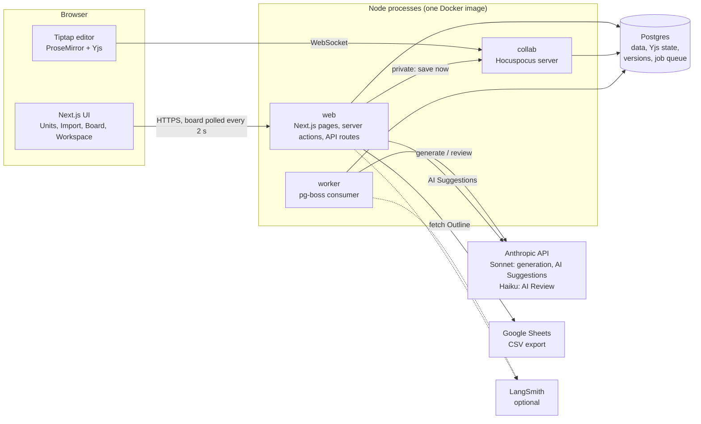
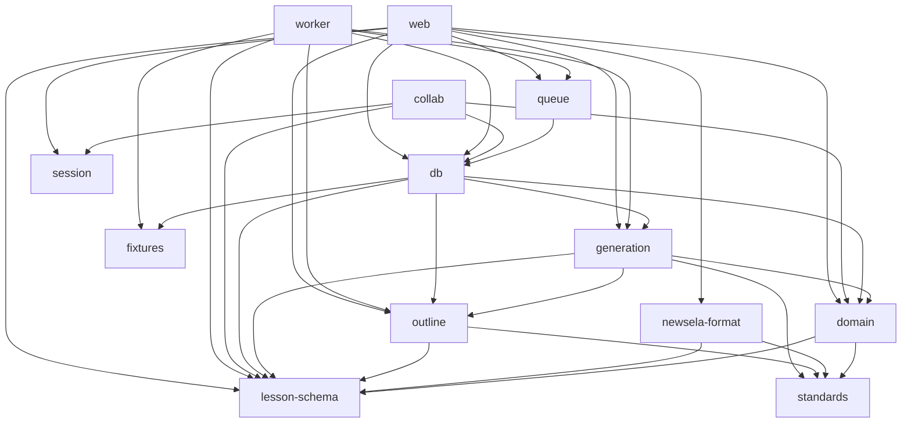
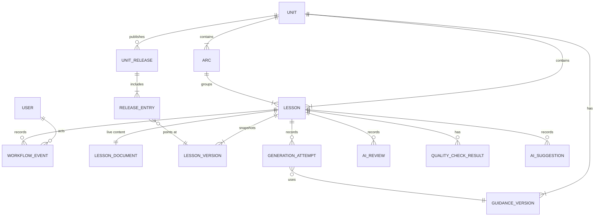
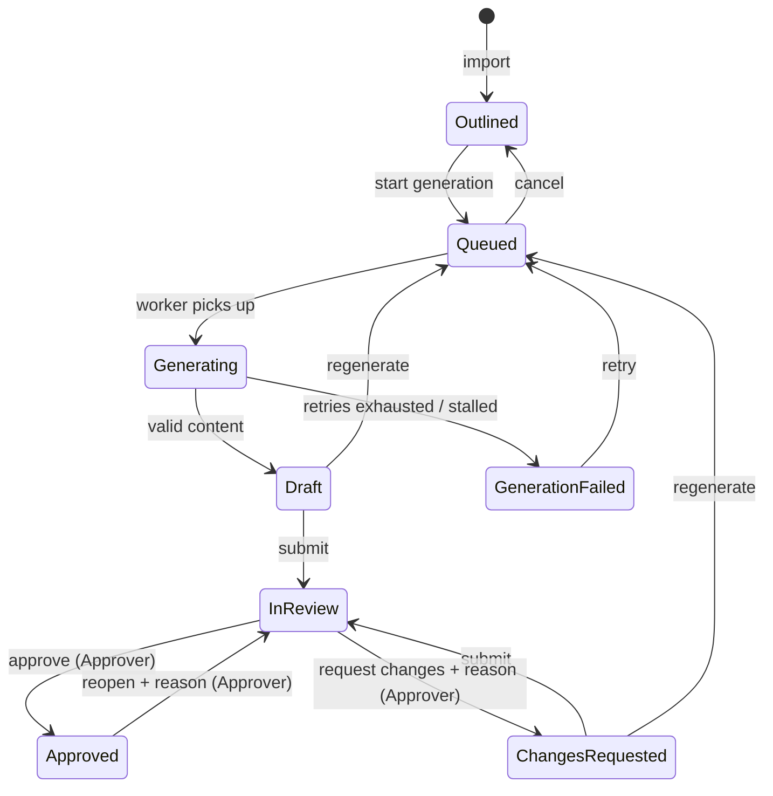
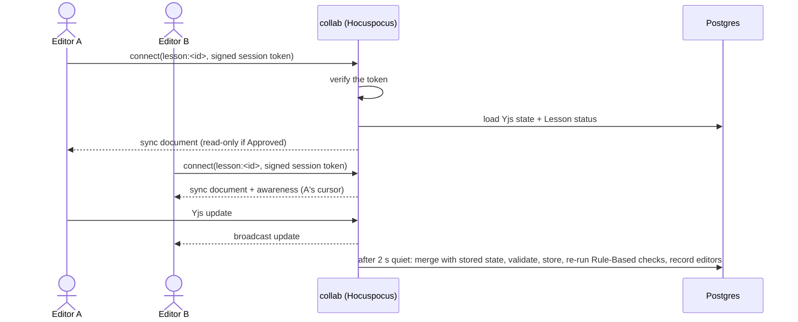
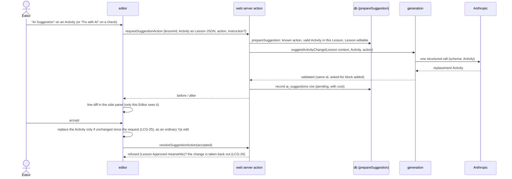

# Architecture

How the Lesson Content Generation tool is put together. Requirements are in [PRD.md](PRD.md), vocabulary in [GLOSSARY.md](../GLOSSARY.md), and the reasoning behind each choice in [adr/](adr/). This document describes the system as built. It runs locally in Docker Compose and is hosted on Railway ([deploy.md](deploy.md), [ADR 0012](adr/0012-railway-hosting.md)).

## 1. High-level architecture (HLA)



| Component    | Responsibility | Talks to |
| ------------ | -------------- | -------- |
| **web**      | Every screen. Server actions for import, workflow, assignment, Versions, publishing and AI Suggestions; API routes for the board (polled every 2 s while generation runs) and Release downloads | Postgres, collab (save now), Anthropic (AI Suggestions), Google Sheets |
| **collab**   | Syncs Lesson documents between browsers; authenticates connections; merges, validates and stores Yjs state; opens Approved Lessons read-only | Postgres |
| **worker**   | Runs Generation Attempts and AI Reviews from the job queue at a fixed concurrency; writes documents, Versions, Digests and checks; fails stalled generations | Postgres, Anthropic |
| **Postgres** | The only stateful service ([ADR 0003](adr/0003-postgres-only-state-and-pg-boss-queue.md)) | none |

The model runs in one of three modes, set by `LLM_MODE`: `live`, `replay` (serves the recorded live run) or `fake` ([ADR 0005](adr/0005-direct-anthropic-sdk-no-agent-framework.md)).

Key properties:

- **One source of truth per kind of fact.** Standards text comes from the checked-in dataset ([ADR 0006](adr/0006-checked-in-standards-dataset.md)). Lesson content comes from the Lesson document. Workflow state comes from the Lesson row and its event log.
- **Lesson content flows through one module.** Live edits arrive through collab. Generated content and version restores go through the same document persistence module, `packages/db/src/documents.ts` ([ADR 0004](adr/0004-hocuspocus-yjs-live-collaboration.md)).
- **Rules live in pure packages, and stored state lives in `db`.** Apps are thin adapters ([ADR 0002](adr/0002-typescript-pnpm-monorepo.md)).

## 2. Low-level architecture (LLA)

### 2.1 Workspace layout

```
apps/
  web/             Next.js pages, server actions, API routes, editor UI
  worker/          job handlers: generate-lesson, review-lesson; stall sweep
  collab/          Hocuspocus server: auth, persistence, read-only guard; scripts/load-test.ts
packages/
  domain/          Lesson state machine, permissions, Quality Check rules, release rules, AI Suggestion actions (pure)
  lesson-schema/   Lesson JSON schema, ProseMirror schema, conversions, Student View, Activity replacement (pure)
  outline/         Outline parsing (CSV, XLSX, Google Sheets), Outline Issue detection, import resolution
  standards/       built standards dataset and lookups; scripts/build-standards.ts
  generation/      prompt builder, model clients (live/replay/fake), generation, AI Review, AI Suggestions
  db/              Drizzle schema, migrations, every read and write of stored state, demo seed; scripts/answer-key.ts
  queue/           job-queue interface + pg-boss implementation
  session/         signs and verifies the session token (web and collab)
  newsela-format/  Release export in the shape of Newsela's published lesson objects
fixtures/          sample Outlines, a hand-written Lesson, example Lessons, recordings of the live run
e2e/               Playwright end-to-end tests (Unit path, AI Suggestions)
```

### 2.2 Package dependencies



`domain`, `lesson-schema` and `standards` do no I/O and depend on nothing outside the workspace except schema and validation libraries. Everything else depends inward on them. `fixtures` is read only where recordings and seed data are needed: the worker's replay client and the demo seed.

### 2.3 Data model



- `LESSON.status` holds the current workflow state. `transition_count` is used for optimistic concurrency on transitions, and `content_digest` is the digest of the stored content.
- `LESSON_DOCUMENT` holds Yjs state as bytes; `LESSON_VERSION` holds immutable Lesson JSON.
- `QUALITY_CHECK_RESULT` rows record the content digest they judged. Only rows matching the Lesson's current digest count on the board, in filters and in the approval warning (LCG-19).
- `GENERATION_ATTEMPT`, `AI_REVIEW` and `AI_SUGGESTION` each record the model, mode, tokens and cost of every call. The Unit cost sums the live ones.
- `WORKFLOW_EVENT` is append-only and is the audit trail: actor, from, to, reason, self-approval flag and failing-checks flag.
- `UNIT` holds `latest_release_id` and `has_unpublished_changes`.

### 2.4 Lesson workflow



Editable states: Draft, In Review, Changes Requested. Approved is read-only, enforced by `collab` (connections open read-only) and by the server actions. AI Suggestions follow the same rule.

### 2.5 Lesson document

One structured ProseMirror document per Lesson ([ADR 0001](adr/0001-lesson-as-one-structured-document.md)):

```
lesson
├── lessonHeader   (standards, objectives, essential questions, vocabulary, texts; pacing shown)
├── section[launch]
├── section[literacy-lab]       (Lesson Type dependent)
├── section[learning-in-action]
│     └── activity (id, title, minutes, standards[], routine)
│           ├── teacherScript (say / ask / teach) / directions / paragraph / sampleResponse / teacherNote
│           ├── pulseCheck (stem, choices, one correct, rationales)
│           ├── eldPanel (purpose, sayAsk, watchFor)
│           ├── supportTable (rows: situation → try this)
│           └── textReference (title, pages)
├── section[look-back]
└── section[homework]
```

Whether a block is teacher-only is fixed by its type: scripts, sample responses, notes, ELD panels and support tables are always teacher-only, so a sample answer can never be marked shared by mistake. Only a plain paragraph chooses its audience. The Student View removes teacher-only blocks and Pulse Check answers. A `textReference` block points students at a Lesson Text and the pages or part used. Flex Day Huddles are Activities whose routine is "Huddle".

The Sections required by each Lesson Type and their order are fixed:
- In the editor, a ProseMirror plugin stops anyone deleting or reordering Sections.
- On the server, the schema rejects any stored content that breaks the plan (LCG-5).

### 2.6 Prompt assembly (generation)

In prompt order:

| Layer | Source | Editable | Cached |
| ----- | ------ | -------- | ------ |
| Locked instructions: role, structure rules, standards rules, and the JSON Schema of the reply | `generation` package | No | Yes (prefix) |
| Unit context: anchor text, Performance Task, Arc descriptions, Generation Guidance version | Unit, Arcs | Guidance only (Editor) | Yes |
| Example Lesson for this Lesson Type (Units 1–3 only) | `generation/data`, built from published Lessons | No | Yes |
| This Lesson: Outline row, neighbouring rows, official text of its standards, Designer Notes | Lesson, standards | No | No |
| Flex Days only: Lesson Digests for the Arc | Lessons | No | No |
| Regenerate only: extra instructions | request | Yes (once) | No |

The reply is JSON described by the schema in the prompt. It is not a structured-output grammar, because the API refuses one at this size (LCG-28). The reply is validated against the Lesson schema, with one repair call.

## 3. Sequence diagrams

### 3.1 Importing an Outline

```mermaid
sequenceDiagram
  actor E as Editor
  participant UI as web UI
  participant API as web server actions
  participant O as outline
  participant S as standards
  participant DB as Postgres

  E->>UI: paste Sheets link / upload CSV or XLSX
  UI->>API: read Outline
  API->>O: parse(source)
  O->>S: normalise + look up every code
  S-->>O: exists / official text
  O-->>API: proposal (Unit, Arcs, Lessons) + Outline Issues
  API-->>UI: import preview + sealed proposal
  E->>UI: resolve issues, edit Unit fields, write Guidance
  UI->>API: create Unit (sealed proposal + resolutions)
  API->>API: refuse a proposal whose seal does not match (LCG-13)
  API->>O: apply resolutions
  O-->>API: confirmed import (no Blocking issues)
  API->>DB: BEGIN; insert Unit, Arcs, Lessons (Outlined), Guidance v1; COMMIT
  Note over API,DB: no jobs yet: generation is started separately
  API-->>UI: redirect to the Unit board
```

### 3.2 Generating a Unit

```mermaid
sequenceDiagram
  actor E as Editor
  participant API as web server actions
  participant DB as Postgres
  participant Q as pg-boss
  participant W as worker
  participant G as generation
  participant LLM as Anthropic
  participant UI as Unit board

  E->>API: start generation (all / trial of 3 / selection)
  API->>DB: BEGIN; Lessons → Queued; enqueue one job per non-Flex Lesson (in the same transaction); COMMIT
  loop up to N concurrent jobs
    W->>Q: fetch job
    W->>DB: Lesson → Generating (a retry refreshes the Lesson, LCG-29)
    W->>G: buildPrompt(Lesson, Unit, Arc, neighbours, standards, guidance)
    G->>LLM: one streamed call (cached prefix with the JSON Schema + Lesson part)
    LLM-->>G: Lesson JSON + Digest
    G->>G: validate against the Lesson schema; repair once if invalid
    G-->>W: content + Generation Attempt + Lesson Digest
    W->>DB: BEGIN; if still Generating: write document, Version "generated", attempt, digest, checks; Lesson → Draft; enqueue Flex Days whose Arc is complete; COMMIT
    Note over W,DB: a late result keeps only its attempt (LCG-30)
    W->>DB: enqueue the AI Review job
  end
  UI->>API: poll the board every 2 s while generation runs
```

On error the job is retried with backoff. When retries are exhausted, the Lesson becomes Generation Failed, with the reason recorded on the attempt. A sweep fails Lessons whose current attempt has been silent for 30 minutes.

### 3.3 Co-editing a Lesson

Whole-Lesson replacements (generation, Regenerate, Restore) are written as Yjs changes on top of the stored document and announced on the `lesson_document` channel. Status changes are announced on `lesson_status`. The collaboration server:
- applies replacements to every open copy;
- closes connections on a status change, so editors reconnect under the new status;
- merges its own saves with what is stored.

The browser also keeps the document in IndexedDB, so offline edits survive a reload.



### 3.4 Approving a Lesson

```mermaid
sequenceDiagram
  actor P as Approver
  participant API as web server action
  participant C as collab
  participant DB as Postgres
  participant D as domain

  P->>API: approve (expected transition count)
  API->>C: save now (open edits reach the database first, LCG-17)
  API->>DB: BEGIN; lock the Lesson row
  API->>API: refuse if the transition count changed (stale view)
  API->>DB: count current failing checks; read the Lesson's editors
  API->>D: decide(status, actor, approve, context)
  D-->>API: Approved (+ selfApproval?, overFailingChecks?)
  API->>DB: update status, transition count; insert event; insert Version "approved"; NOTIFY lesson_status; COMMIT
  DB-->>C: lesson_status
  C-->>P: open editors reconnect read-only
```

### 3.5 AI Suggestion



### 3.6 Publishing a Unit

```mermaid
sequenceDiagram
  actor P as Approver
  participant API as web server action
  participant D as domain
  participant DB as Postgres

  P->>API: publish
  API->>DB: load Lessons + their latest Approved Versions
  API->>D: publishability(Lessons), mayPublish(actor)
  D-->>API: ok (all Approved) / refusal naming what is waiting
  API->>DB: BEGIN; insert Unit Release + entries → Approved Versions; Unit latest Release, no Unpublished Changes; COMMIT
  API-->>P: Release n (download JSON, or Newsela format)
```

## 4. Cross-cutting concerns

- **Identity and authorisation:** a signed session token, carried by the web app's cookie and passed to the collaboration server, is verified by both. Every action is checked by `domain` permission rules ([ADR 0010](adr/0010-identity-supplied-upstream.md)).
- **Concurrency:**
  - Yjs merges simultaneous edits.
  - Workflow transitions lock the Lesson row and compare `transition_count`.
  - Jobs carry a queued-at stamp, so a cancelled job never runs.
  - AI Reviews replace their results under a row lock.
- **LLM modes:** `LLM_MODE=live|replay|fake`. LangSmith wraps the client only when `LANGSMITH_TRACING=true` ([ADR 0005](adr/0005-direct-anthropic-sdk-no-agent-framework.md)).
- **Errors:** handled at boundaries (server action results, job handler, UI error boundary). Model calls record their cost even when they fail.
- **Performance:**
  - The Unit board reads one aggregated query per Unit, polled every 2 s only while generation runs.
  - Documents load only in the workspace.
  - collab persists debounced.
  - 25 simulated reviewers saw edits arrive in 11 ms at the median ([QUALITY.md](../QUALITY.md)).
- **Deployment:** one Docker image runs every process. Docker Compose runs it locally; Railway runs the hosted copy, with three services and Railway Postgres ([deploy.md](deploy.md)).
